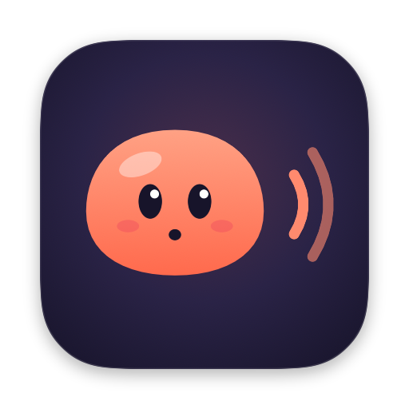
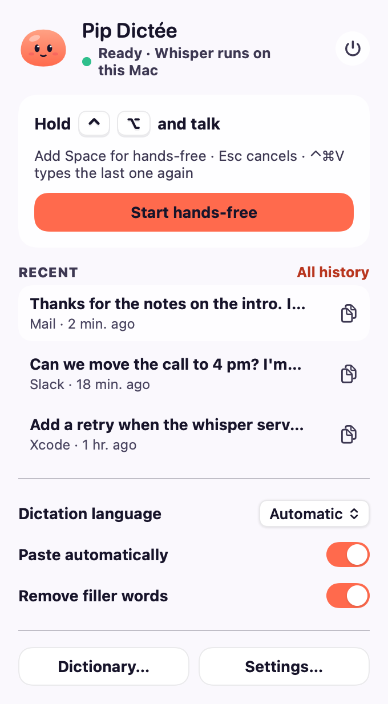
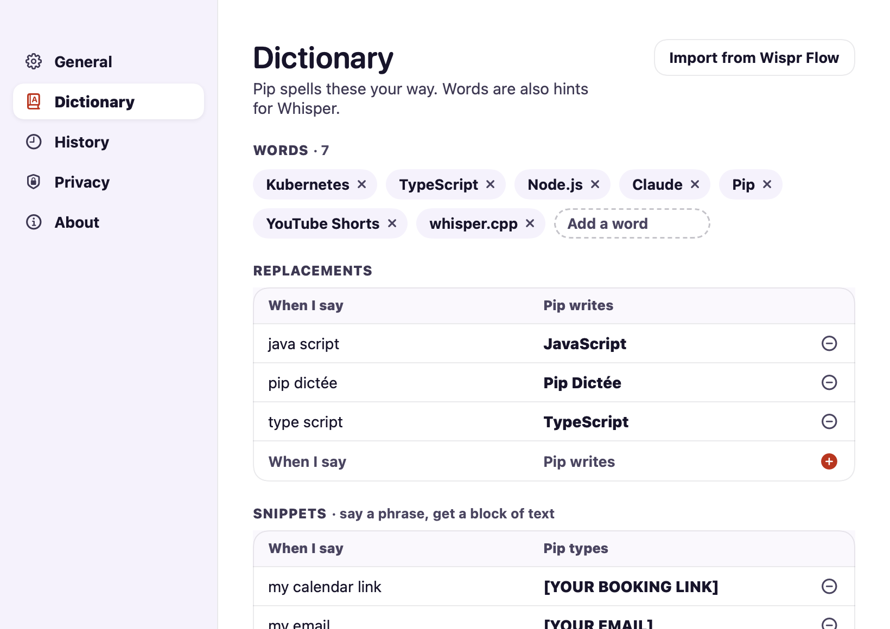
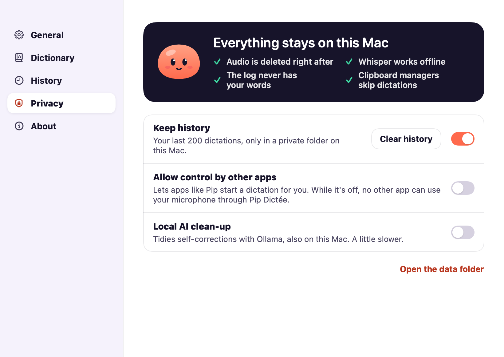

<p align="center">
  
</p>

<h1 align="center">Pip Dictée</h1>

<p align="center">
  <b>Hold a key. Talk. Let go. Pip types it.</b><br>
  Free, open-source voice dictation that runs entirely on your computer. macOS and Windows.
</p>

<p align="center">
  <a href="https://github.com/BabaScience/PipDictee/actions/workflows/ci.yml"></a>
  <a href="LICENSE"></a>
  
  
</p>

<p align="center">
  
</p>

---

You're writing an email, a message, some code. Instead of typing, hold **Ctrl + Option** (Mac) or **Ctrl + Win**
(Windows) and say it. Let go, and about a second later your words are there, where your cursor was, cleaned up and
spelled the way you like. In any app.

Pip doesn't send your voice anywhere. Whisper, the speech-recognition model, runs on your own machine. No account,
no subscription, no "we may use your recordings to improve our services". Your words are yours.

## What Pip does



- **Push-to-talk, anywhere.** Hold the shortcut, speak, release. Mail, Slack, Word, VS Code, a web form: if it
  takes text, Pip can type in it.
- **Hands-free for long thoughts.** Add **Space** while holding the shortcut and let go of the keys. Press the
  shortcut again when you're done. **Esc** cancels, no hard feelings.
- **Tidies up after you.** "Euh", "um", "äh" disappear. "New paragraph" becomes a new paragraph. Whisper's habit
  of hearing "Thank you for watching!" in silence is politely ignored.
- **Spells things your way.** Teach it your words (Kubernetes, your colleagues' names), fixes (`type script` →
  `TypeScript`) and snippets (say "my email", get your address).
- **Six languages, and more.** Dictation clean-up for English, French, German, Italian, Spanish and Portuguese, plus
  ~90 more languages Whisper understands, with automatic detection. The app itself speaks those six languages too.
- **Honest when it didn't work.** "I didn't hear anything" beats an empty paste.

<br clear="right">

<p align="center">
  
  
  
</p>

## Get started

### macOS 14 Sonoma or later

```bash
brew install whisper-cpp                         # the speech engine (https://brew.sh)
git clone https://github.com/BabaScience/PipDictee.git && cd PipDictee
./macos/build.sh install                         # builds and starts the app (needs Xcode command-line tools)
```

Pip greets you and walks you through setup: it checks it can hear you, asks for Accessibility (so it can notice
the shortcut and type for you), downloads the voice model once (1.6 GB, checked with SHA-256), and lets you try a
first dictation.

> Building it yourself? macOS asks for the permissions again after each rebuild unless you sign with your own
> identity: see the top of [`macos/build.sh`](macos/build.sh).

### Windows 10 / 11

```powershell
git clone https://github.com/BabaScience/PipDictee.git; cd PipDictee\windows
cargo build --release                            # needs Rust: https://rustup.rs
.\target\release\PipDictee.exe
```

Setup does the rest: microphone check, then whisper.cpp and the model (1.6 GB, checked with SHA-256). Pip lives in
the notification area: click it for the panel, right-click for Settings and Quit. Have an NVIDIA GPU? Run
`scripts\setup-windows.ps1 -Cuda` first for a faster engine.

> The Windows edition is brand new. If something looks off, please [open an issue](../../issues): it really helps.

## Shortcuts

| | macOS | Windows |
|---|---|---|
| Dictate | hold **⌃⌥**, speak, release | hold **Ctrl + Win**, speak, release |
| Hands-free | **⌃⌥ + Space** … **⌃⌥** | **Ctrl + Win + Space** … **Ctrl + Win** |
| Cancel | **Esc** | **Esc** |
| Type / copy the last dictation again | **⌃⌘V** / **⌃⌘C** | click it in the panel to copy it |
| Everything else | click Pip in the menu bar | click Pip in the notification area |

The shortcut can be changed in Settings (fn, right ⌥ or right ⌘ on a Mac; right Ctrl on Windows).

## Your dictionary



Open **Settings › Dictionary** to add words Pip should spell right, replacements, and snippets. Already using
Wispr Flow on a Mac? **Import from Wispr Flow** brings your words over (read-only: nothing is changed there).

It's a plain JSON file in your data folder, if you prefer editing by hand:

```json
{ "words": ["Kubernetes", "Pip"],
  "replacements": { "type script": "TypeScript" },
  "snippets": { "my email": "[YOUR EMAIL]" } }
```

<br clear="right">

## Privacy



- **Your voice stays on your computer.** Audio is recorded to a temporary file and deleted as soon as it's
  transcribed. Transcription runs locally, through a server that only listens on `127.0.0.1`.
- **One download, at setup.** The voice model (and whisper.cpp on Windows) comes from Hugging Face and GitHub over
  HTTPS, and is checked against a pinned SHA-256 before use. After that, Pip works offline.
- **Your history is yours.** The last 200 dictations are kept in a folder only your user can read. Turn history
  off or clear it anytime.
- **No secrets in logs.** The log records timings and lengths, never what you said.
- **Clipboard managers look away.** Dictations are marked so clipboard history apps (and Windows' cloud clipboard)
  don't keep them.
- **No other app can borrow your microphone through Pip** unless you allow it in Settings.

The details, and how to report a vulnerability: [SECURITY.md](SECURITY.md).

<br clear="right">

## Questions

**Is it really free?** Yes. MIT-licensed, no account, no paid tier, no telemetry.

**Does it work offline?** Yes, once the model is downloaded.

**How fast is it?** About a second for a sentence on an Apple Silicon Mac. On Windows it depends on your CPU; the
CUDA build helps a lot on an NVIDIA GPU.

**What do I need?** A Mac with macOS 14 or later (Apple Silicon recommended), or a Windows 10/11 PC, and about
2 GB of free disk space for the model.

**Pip says "I didn't hear anything".** The recording was too short or too quiet. Check the microphone selected in
your system's sound settings; setup shows which one Pip is using.

**Can I use another model?** Not from the settings yet: Pip uses Whisper `large-v3-turbo`. A smaller-model option
would make a great first contribution.

**Is this affiliated with Wispr Flow?** No. Pip Dictée is an independent project, inspired by push-to-talk
dictation tools like Wispr Flow, and not affiliated with or endorsed by them.

## Contributing

Bug reports, translations, ideas and code are all welcome. Start with [CONTRIBUTING.md](CONTRIBUTING.md); the design
and how the pieces fit are in [docs/ARCHITECTURE.md](docs/ARCHITECTURE.md). Translations are plain JSON files in
[`shared/i18n/`](shared/i18n), and native speakers are especially welcome to polish them.

Please be kind: [CODE_OF_CONDUCT.md](CODE_OF_CONDUCT.md).

## Credits

- [whisper.cpp](https://github.com/ggml-org/whisper.cpp) by Georgi Gerganov and contributors (MIT), running
  OpenAI's [Whisper](https://github.com/openai/whisper) model (MIT).
- [Silero VAD](https://github.com/snakers4/silero-vad) for voice detection (MIT).
- The Windows app is built with Rust crates under MIT, Apache-2.0, BSD, Zlib and Unicode licences, plus one
  unmodified MPL-2.0 crate (`option-ext`); `cargo tree` in `windows/` lists them all.
- Pip, the coral pebble, is the character of the Pip project.

## License

[MIT](LICENSE) © Pip Dictée contributors.
