# Architecture

Pip Dictée is push-to-talk dictation that never leaves the computer: hold a shortcut, speak, release, and the
text appears where the cursor is. Two native apps share one design, one data format and one set of text
clean-up rules.

## Repository layout

```
PipDictee/
├── macos/                    native macOS app (Swift: AppKit + SwiftUI), no dependencies
│   ├── Sources/                 main (entry, test hooks), Core (files, clean-up, Whisper), App (shortcut,
│   │                            recording, typing), Model, Theme (Pip), Pill, Panel, SettingsView,
│   │                            Onboarding, Snapshots
│   ├── Info.plist
│   ├── PipDictee.entitlements   hardened runtime: microphone only
│   └── build.sh                 swiftc → build/Pip Dictée.app (signing.local = your identity, git-ignored)
├── windows/                  native Windows app (Rust + WebView2 for the windows)
│   ├── Cargo.toml, build.rs     build.rs embeds the icon in the .exe (on Windows)
│   ├── ui/ui.html               every window's interface: pill, panel, settings, setup (open it in a browser
│   │                            with #gallery&lang=fr to see them all with sample data)
│   ├── assets/                  tray and app icons, rendered from the macOS Pip (scripts/make-windows-assets.sh)
│   └── src/
│       ├── main.rs
│       ├── cleanup.rs           text clean-up (portable, unit-tested on every OS)
│       ├── store.rs             files, settings, dictionary, history (portable)
│       └── win/                 Windows-only: app.rs (windows, tray, bridge, controller), hook.rs (shortcut),
│                                audio.rs (WASAPI via cpal), whisper.rs (server), output.rs (paste),
│                                setup.rs (verified downloads), autostart.rs (open at sign-in)
├── shared/
│   ├── cleanup-cases.json    the contract both clean-ups must pass
│   └── i18n/<lang>.json      interface translations (fr, de, it, es, pt), used by both apps
├── scripts/
│   ├── setup-macos.sh        whisper.cpp via Homebrew + model, SHA-256 checked
│   └── setup-windows.ps1     whisper.cpp release + model, SHA-256 checked
├── docs/ARCHITECTURE.md      this file
├── .github/                  CI (build both apps, run tests, scan for secrets), Dependabot
└── .githooks/pre-commit      refuses commits that contain secrets or personal data files
```

Why two native apps instead of one cross-platform toolkit? The hard parts of dictation are all OS-specific: a
global push-to-talk shortcut, the microphone permission, typing into another app, a tray/menu-bar icon. A
cross-platform UI layer would still need native code for each, and would add a browser engine or runtime to an
app that is otherwise a few hundred kilobytes. What *is* shared is kept identical by contract (see below).

## The pipeline

```mermaid
flowchart LR
    K[Shortcut held<br/>CGEventTap / WH_KEYBOARD_LL] --> R[Record mic<br/>16 kHz mono WAV in temp dir]
    R -->|release| W[whisper-server<br/>127.0.0.1:18765]
    W -.server down.-> C[whisper-cli fallback]
    W --> T[clean&#40;&#41;<br/>fillers, layout words,<br/>dictionary, snippets]
    C --> T
    T -.optional, macOS.-> O[Ollama polish<br/>127.0.0.1:11434]
    T --> P[Clipboard + paste<br/>⌘V / Ctrl+V]
    O --> P
    T --> H[(history, 200 max)]
```



1. **Shortcut.** macOS: a `CGEventTap` (needs Accessibility), with a Carbon hot key as a fallback before the
   permission is granted. Windows: a low-level keyboard hook (no admin rights needed). Hold to talk; add Space for
   hands-free; Esc cancels; any other key while holding means "this was another shortcut" and cancels silently.
2. **Recording.** 16 kHz mono 16-bit WAV in the per-user temp folder, deleted right after transcription.
   Leftovers from a crash are deleted at the next launch. A take that is too short or too quiet is dropped.
3. **Transcription.** whisper.cpp `large-v3-turbo`, kept loaded in `whisper-server` bound to `127.0.0.1`.
   Silero VAD skips silences when its model is present. The dictionary's words are passed as the prompt to bias
   spelling. If the server is down, `whisper-cli` is used.
4. **Clean-up** (`clean()` in Swift, `cleanup::clean` in Rust): removes Whisper's known hallucinations
   ("Thank you for watching"), sound tags, hesitations (euh, um, äh), turns spoken layout words into line breaks
   ("nouveau paragraphe", "new line", "a capo"), fixes spacing and capitals, then applies the user's
   replacements and snippets.
5. **Output.** The text is put on the clipboard (marked so clipboard managers and Windows clipboard history
   don't keep it) and pasted with a synthetic ⌘V / Ctrl+V into the app that was in front.

## Shared contract

| What | macOS | Windows |
|---|---|---|
| Data folder | `~/Library/Application Support/Pip Dictée/` (0700) | `%APPDATA%\Pip Dictée\` |
| Model folder | `…/Pip Dictée/models/` | `%LOCALAPPDATA%\Pip Dictée\models\` |
| Dictionary | `dictionary.json` — `{ words: [], replacements: {}, snippets: {} }` | same file, same format |
| History | `history.json` — `[{ text, at (ISO 8601), app }]`, max 200 | same |
| Settings | `UserDefaults` (`fr.pip.dictee`) | `settings.json` |
| Server | `whisper-server` on `127.0.0.1:18765` | same |
| Default shortcut | Ctrl + Option | Ctrl + Win |
| Interface language | system (or per app in System Settings); `<lang>.lproj` built from `shared/i18n` | Windows display language; `shared/i18n` built into the exe |

`shared/cleanup-cases.json` lists input → expected output pairs. CI runs them against both implementations
(`PipDictee --test-cleanup` on macOS, `cargo test` for Rust). **Any change to clean-up must update both
implementations and this file in the same commit.**

## Platform differences (known)

| Feature | macOS | Windows |
|---|---|---|
| Floating pill with Pip's moods, panel, settings window, first-launch setup | ✓ SwiftUI | ✓ WebView2 (`windows/ui/ui.html`) |
| Setup downloads (model, engine), SHA-256 checked | model in-app; whisper.cpp via Homebrew | both in-app (schannel TLS, HTTPS only) |
| App language picker | ✓ | ✓ |
| Paste last / copy last shortcuts | ⌘⌃V / ⌘⌃C | panel: click a recent dictation to copy it |
| Optional Ollama polish | ✓ | to do |
| Import Wispr Flow dictionary | ✓ | to do |
| Open at login | ✓ (`SMAppService`) | ✓ (HKCU `…\CurrentVersion\Run`) |
| GPU | Metal (Homebrew build) | CUDA build via `setup-windows.ps1 -Cuda`, else CPU |

## Roadmap ideas

- Windows: Ollama polish, Wispr Flow import, the app name in "Typed in …", bundled Fredoka/Nunito fonts.
- Pick a free port at launch instead of 18765, and pass a random token to the server.
- More interface languages: one `shared/i18n/<lang>.json` each (see CONTRIBUTING.md).
- Signed and notarised macOS releases; signed Windows installer (MSIX).

## UI design

The target UI is drawn in [`design/ui/`](../design/ui/) (Design canvas files, one `.dc.html` per board), in the
same visual language as Pip: the coral Pip character, Fredoka + Nunito, ink / coral / lilac. The app's states
are Pip's moods: *listening* (coral, leaning in), *thinking* (eyes up, dots), *done* (mint, happy eyes),
*honest oops* (nothing heard), *needs you* (amber, the only state that waits for a click).

| Board | What it shows |
|---|---|
| `Main` | Dictating into Mail: menu-bar glyph, keys held, the pill |
| `Flow` | Hold → talk → let go → tidied up → typed, and what happens under the hood |
| `Pill-States` | The eight states of the floating pill |
| `Brand` | App icon, menu-bar/tray glyphs, colours, type, tone of voice |
| `Menu` | Menu-bar panel (to replace today's text menu): recent dictations, quick settings |
| `Settings`, `Privacy` | Settings window: editable dictionary, history and privacy controls |
| `Onboarding` | First launch: microphone, Accessibility, model download, first dictation |
| `Windows` | The same design on Windows 11, Ctrl + Win, tray icon |

**macOS: built.** SwiftUI, in `macos/Sources/`: `Theme.swift` (colours, Pip and its moods, menu-bar glyph,
controls), `Pill.swift`, `Panel.swift` (menu-bar popover), `SettingsView.swift`, `Onboarding.swift` (permissions, model
download checked with SHA-256, first dictation). Headlines use SF Rounded, the system face closest to Fredoka.
`PipDictee --snapshot <folder>` renders every screen to PNG with sample data (native menus and text fields show as
placeholders in snapshots).

**Windows: built, in WebView2.** One page, `windows/ui/ui.html`, draws every window (same Pip, colours and moods,
drawn in SVG from the same curves). Rust creates the windows (tao + wry), and the page talks to it with a small JSON
bridge (`app.rs`, `Ui::ipc`): every message is checked, links can only open four fixed destinations, the page can't
navigate or open windows, and user text is only ever set as text. No Accessibility step on Windows: the keyboard
hook needs no permission, so setup has four steps (welcome, microphone, downloads, try it).
